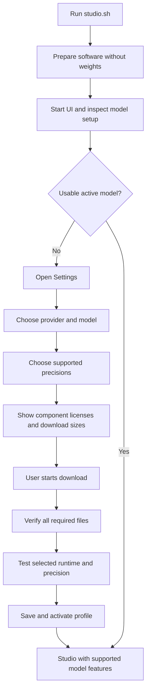

# Product and architecture contract

This is the product contract for Lux In Music. The requirement ledger records
implementation status and executable checks. Duration-aware endings have a
recorded native audio test and user listening acceptance.

## Purpose

Lux In Music is a generative music application with a shared studio, job queue,
library, and editing UI. Local generation uses models compatible with audio.cpp.
The shared application should not depend on one model family. A future provider,
such as MiniMax, would need a separate integration and documented capabilities;
it is not assumed to run through audio.cpp or to expose local weights or a VAE.

## Current implementation

Shared song inputs, queue, results and library use provider/profile contracts.
`studio/adapters/yue2.py` owns YuE2 options, token rates and capability declarations;
`yue2_edit.py` owns its semantic editing format. Shared audio helpers read actual
WAV rates. `studio/providers.py` owns audio.cpp transport, process lifecycle and
runtime probes. Generation and separation have separate lazy runtime slots.

Studio Mode section edits accept an optional, bounded text direction separate
from lyrics. The YuE2 edit adapter adds it to a temporary style prompt while it
samples the selected semantic section; the edit pipeline still separates and
replaces only the chosen stem in the selected time range. The direction is saved
with the resulting take. YuE2 has no dedicated section-scoped instruction input,
so this is a creative cue, not a guarantee of exact compliance.

Genre templates belong to the shared Create UI: they load the shared Melodic
Techno demo lyrics with a genre style, preserve title/settings, and make no
inference request. The lyric text has one source in the existing demo.

Settings uses the pinned catalog and `studio/models.py` to verify/download files,
record license reviews, and activate tested profiles. The UI starts without an
engine. `studio.sh` prepares software, without weights, before serving the UI.
There is no active model on a fresh install. The previous Q8_0/F16 files are
detected as migration candidates, but require license review and verification.

## Local image-to-style suggestions (LUX VIBE)

Vibe is an optional, independent local embedding feature. It is not a generation
or separation provider and never changes the active music profile. Its dedicated
`studio/vibe.py` manager downloads only the pinned EmbeddingGemma model artifacts
to the ignored local `models/vibe/` directory after an explicit Settings license
review and action. The model, its files and licenses are pinned under
`optional_models` in `config/model-catalog.json`, separate from music profiles,
with the same SHA-256/git blob hashes as music models. Before downloading, Lux
compares the Hugging Face metadata for the pinned revision with those hashes;
after downloading, it hashes each file and removes any mismatch so a retry fetches
a clean copy. The upstream repository is not copied into Lux source. Vibe
runtime packages are prepared at that same explicit action; normal setup and app
startup install neither those packages nor model weights.
Base dependency synchronization uses `--inexact` to preserve optional runtime
packages already installed through Settings. Restarting Lux must not uninstall
Vibe or trigger another runtime installation.

Implementation follows Google's [EmbeddingGemma 2 model card](https://ai.google.dev/gemma/docs/embeddinggemma/model_card_2)
and [Sentence Transformers multimodal guide](https://ai.google.dev/gemma/docs/embeddinggemma/multimodal-embeddinggemma-with-sentence-transformers).

The runtime loads lazily from the local model directory with
`local_files_only=True`. It does not set process-wide Hugging Face offline
flags: huggingface_hub reads them once at import, so they would block a later
verify/repair download until Lux restarts. Sentence Transformers uses text and image encoders,
sets `audio_config=None`, uses FP32 and prefers Apple MPS with CPU fallback. The
model is released when leaving Vibe so music generation can reclaim memory.
Vibe accepts one to five images, each limited to 10 MiB and 20 megapixels.
Images are validated, EXIF-oriented and embedded sequentially in a worker
thread, so the event loop stays responsive and full-size decoded images do not
accumulate. Analysis does not retain uploads. Use in Create snapshots the
collection in the browser. Generation prepares metadata-free JPEGs and a square
mosaic cover when multiple images are present. Each completed song owns its
cover and gallery artifacts. Private queue fields hold prepared images until
completion, failure or cancellation. Image bytes and catalog IDs remain outside
music-model inputs; actual music options are recorded in the normal song params.
Deleting one variation removes its own cover and gallery. Images are not logged
or sent to a remote service. Legacy single-cover metadata remains supported.

Vibe songs use their image throughout Library, Studio Mode, details and player.
Playback opens a softly fading image view above the player. Galleries advance
every eight seconds with a 1.6-second crossfade, using two decoded image layers.
Manual arrows and a slideshow pause control remain independent of audio.
Automatic advancement stops while audio is paused or the tab is hidden.
Closing the view keeps it dismissed during pause/resume of that track; the
player cover reopens it. Reduced-motion preferences disable transitions and
automatic advancement. Song details identify the source collection and count.

`studio/static/vibe-effects.js` owns an optional local playback visualization.
One lazily attached MediaElementAudioSourceNode feeds an AnalyserNode and the
audio destination without filters or gain changes. The context must resume
before attachment, so initialization failure leaves native playback available.
It stays alive after attachment because it carries the player's audio; toggling
effects only stops drawing. RMS amplitude and bass/mid/treble bands control
smoothed light pools that slowly trade colors, a beat-pulsing halo bloom and
rotating light shafts behind the artwork, rising treble sparkles, liquid
ribbons and mirrored spectrum bars; the artwork itself carries an
energy-driven glow. Bass onsets above their recent floor kick the halo.
Canvas work is capped at 960 × 720 pixels and 30 frames per second. Closing,
pausing or hiding the tab cancels the animation loop; reduced-motion preferences
disable it. Effects On / Off is keyboard accessible and saved in localStorage.
No microphone, embedding inference or extra network requests are involved.

The 120-entry local catalog maps visual descriptions to musical directions.
Vibe embeds its text descriptions once and caches normalized 768-dimensional
vectors using a cache key bound to model revision, catalog contents and prompt
configuration. Each image is normalized and matched individually. The normalized
mean of image vectors selects a shared direction through cosine similarity;
distinct image matches add curated instrumental textures. This deterministic
blend uses catalog text rather than a generative language model. The interface exposes the selected direction,
not embeddings or similarity scores. This is a creative association, not an
objective classification or image caption. No tuning or training occurs.

An adapter can provide `vibe_options(diversity)` to suggest supported Advanced
controls. YuE2 maps mean pairwise cosine distance to three conservative creative
presets: cohesive, balanced or contrasting. Presets vary semantic temperature,
top-p and top-k within existing UI bounds. Every Vibe preset suggests 8 rendering
steps for a lighter generation; the user can still edit Advanced. The image-to-sampling
mapping is a Lux heuristic, not an upstream quality recommendation. The Vibe UI
shows the values, allows opt-out, applies only controls declared by the active
adapter, and skips suggestions if the music profile changed after analysis.
No generation profile is activated or changed by Vibe analysis.
Vibe transfer preserves existing lyrics. If the field is blank, it uses the
same starter lyrics as a fresh Create form without changing instrumental mode.

The model's files are about 1.53 GB even though the audio encoder is disabled at
runtime. This setting avoids loading the audio encoder; it does not shrink the
downloaded checkpoint. Once software and model installation are complete,
inference needs no network access.

## Local recorded melodies (LUX HOOK)

Hook is a separate `#/hook` page between Vibe and Studio Mode. It records mono
PCM through an AudioWorklet or accepts one browser-decodable audio file. The
browser converts the recording to a metadata-free WAV before sending it to
`POST /api/hook/analyze`; the server validates the actual content, byte size,
channels, sample rate, finite samples, length and selected range before analysis.
The limits are 25 MiB and 2–90 seconds. Leaving Hook stops microphone tracks.
Original recordings remain in memory, outside songs, queue payloads and logs.
Hook's Audio input settings lists browser-visible audio inputs, persists the
chosen device ID in localStorage and requests it with an exact media constraint.
Device discovery does not request permission automatically; Refresh audio inputs
does so explicitly and closes the temporary stream. Disconnected inputs require
reselection instead of silently switching microphones. Capture stops on track
termination or leaving Hook. Inputs belong to the browser's device, including
when a user opens a Lux server running on another computer.

`studio/hook.py` owns explicit SheetSage2 and MERT setup, file verification, and offline transcription. These weights are pinned in `config/hook-sheet-model.json`, separate from audio.cpp generation profiles; both use CC BY-NC 4.0. Settings requires review and explicit acceptance before downloads. Setup installs a hash-locked Python 3.11 runtime under ignored `.lux/experiments/`; normal bootstrap and startup install neither Hook software nor weights. Analysis uses the local artifacts only, with FP32 on Apple Metal when available and CPU fallback. No inference request downloads files or contacts a remote service.

The server validates the uploaded audio, analyzes only the selected range, and invokes a short-lived isolated process. That process and its temporary files are removed after analysis, releasing model memory. The UI previews the melody and tempo from SheetSage2's melody-only score. In Develop mode, bounded note events guide the planner's chorus; Arrange mode uses the model's full melody-only ABC score and its approximate timing. The YuE2 adapter validates the score and retains its existing duration and ending checks. Instrumental generation keeps the extracted melody in the score. This is score conditioning, not waveform editing or voice cloning.

The Hook reference is an adapter option gated by the `hook` capability, captured with queued inputs and retained in song parameters. Library/details identify the recorded-melody origin. Use in Create preserves title, lyrics, style, seed, Advanced values and Vibe artwork; it selects Melody planning. It refuses to silently replace a custom ABC. No music generation occurs during analysis. Hook inference is serialized and runs off the FastAPI event loop; model setup and music jobs must finish first.

SheetSage2 can recover several musical parts, but Hook intentionally transfers its melody-only score. A transcription is a musical suggestion: instrument identity, exact notes and the final arrangement are not guaranteed. The noncommercial model terms apply to users of these weights; Settings links to both upstream licenses before download.

The Hook reference is an adapter option, gated by the `hook` capability, captured
with queued inputs and retained in song parameters. Library/details identify the
recorded-melody origin. Use in Create preserves title, lyrics, style, seed,
Advanced values and Vibe artwork; it selects Melody planning. It refuses to
silently replace a custom ABC. No music generation occurs during analysis.
Hook inference is serialized and runs in a worker thread. Music jobs/setup must
finish first; new music generation, model setup and launcher restarts are held
while analysis runs. The small pitch session can be released on navigation.

Automated checks use synthetic PCM and fake provider outputs, including a
synthetic browser microphone. Real transcription, motif adherence and final song
quality still require audio/listening acceptance.

## Startup and Settings flow

1. Installing Lux installs software dependencies, without selecting/downloading
   weights. Optional separation weights follow the same opt-in rule.
2. Running the studio must open the UI even when no weights or engine exist.
   With no usable active profile, Settings is the first view; generation is
   unavailable until setup completes. Existing library audio remains accessible.
3. Settings discovers existing downloads and records an explicit selection.
   Missing, incomplete, incompatible, or corrupt files cannot be activated.
4. Show the model and each component's license identifier, source link, revision,
   and material use restrictions before the download action. Record the user's
   acknowledgement for those releases. A changed license/release needs review.
   Unknown licenses need resolution before offering the download.
5. Downloads expose progress, failure/retry, cancellation, verification, and
   the required disk space. Activation failures retain the last working profile.
6. The UI exposes the active model's capabilities. Planning, ABC input, semantic
   editing, VAE selection, and local precision controls are conditional features.

## Boundaries

| Boundary | Responsibilities |
| --- | --- |
| Shared application | Song inputs, queue, library, audio artifacts, Settings UI |
| Provider/runtime adapter | Connection, lifecycle, readiness, request transport, results |
| Model adapter | Parameter validation, capabilities, token/audio formats, model-specific stages |
| Model catalog | Supported artifacts, compatible combinations, licenses, revisions, checksums/sizes |
| Download manager | User-requested transfer, progress, cancellation/resume, integrity verification |
| Model profile store | Selected provider/model/VAE, precisions, paths, readiness and effective configuration |

The shared contract is validated using a small fake provider with no YuE2 options.
An external delivery profile has no local paths, weights, precision or VAE. Its
provider probe confirms readiness. This is an extension point; it does not
implement a third-party service, credentials UI, billing or MiniMax support.

## Storage and activation decisions

- Native source submodules use command-scoped GitHub SSH-to-HTTPS URL rewrites.
  Fresh setup and retries must work without SSH keys. Do not modify global Git
  configuration or the pinned upstream source to select a transport.
- Catalog file URLs, sizes and integrity hashes are tied to immutable releases.
  LFS artifacts use SHA-256; small Git sidecars use Git blob SHA-1.
- Settings records acknowledgement of the exact license/release digest before
  any transfer. A changed release or license document invalidates that review.
- Each release has its own directory. Legacy files are hashed before hardlinking
  or copying into that directory. Replacements are verified before atomic rename;
  old songs' release files are not overwritten by a newer release.
- Partial downloads stay resumable. Invalid ranges and corrupt completed files
  fail setup. Cancellation cannot interrupt an already running native inference;
  it can cancel its wait and prevent activation when the inference finishes.
- Activation requires complete verified files and a valid nonempty WAV from a
  short native probe. Save failure rolls back the in-memory active selection.
  Device/backend or binary fingerprint changes invalidate local readiness.
- Separation profiles declare input sample rate and channels. Both the probe
  and song-separation input conversion use that contract: 44,100 Hz for
  HTDemucs/BS-RoFormer. SAM Audio is no longer offered in Settings or for new
  separations; legacy profile snapshots and saved stem sets remain readable.
  Older saved separation profiles retain their mode-format fallback.
- Restore the active precision/VAE choice and recorded license review in Settings
  after reload. A verified profile can be selected again without hashing or
  probing unchanged files. Compare the current release, files, paths and runtime
  token before reuse. Explicit repair performs full verification again.
- Each model card owns its setup action, progress and latest relevant error.
  Active verified generation and separation profiles have disabled status buttons.
  Successful setup history is not rendered in Settings. Repair is an explicit
  action under Maintenance. New license documents require review, while unchanged
  file/runtime validation can be reused after that acknowledgement.
- A source pin describes the supported native build. External binaries record
  their path and compatibility fingerprint, without claiming a known source revision.
- Provider locks protect a runtime during inference. Queued jobs keep a profile
  snapshot; the runtime switches to that profile when the job runs. No arbitrary
  existing processes are terminated. Only the studio's subprocesses are owned.
- The catalog reports a BS-RoFormer publisher license declaration with its
  original checkpoint provenance caveat. Keep that caveat visible; do not describe
  the declaration as proof of the original checkpoint's licensing history.

## Precision and VAE choices

Published YuE2 audio.cpp artifacts include:

| Component | Precision | Filename |
| --- | --- | --- |
| Main model | Q8_0 | `yue2-3b-q8_0.gguf` |
| Main model | BF16 | `yue2-3b-bf16.gguf` |
| Main model | Q4_0 | `yue2-3b-q4_0.gguf` |
| VAE | F16 | `yue2-vae-f16.gguf` |
| VAE | F32 | `yue2-vae-f32.gguf` |

BF16 and FP16 are distinct 16-bit floating-point formats. Do not rename BF16
as FP16 or invent an FP16 YuE2 download. Choose main weights and VAE separately;
after selecting YuE2, F16 is the default VAE choice and F32 is an alternative.
Each pairing still needs validation with the actual runtime/device.

The requested BF16 main (~7.26 GB) plus F32 VAE (~0.53 GB) has about 7.8 GB of
weights. This rounded estimate is not peak runtime memory. Cache, Metal buffers,
and temporary allocations add overhead. Distinguish GB from GiB and show measured
runtime memory separately when available. Precision is a resource/fidelity choice,
not a guaranteed audible improvement or a fix for song endings.

Source: [pinned YuE2 GGUF release](https://huggingface.co/audio-cpp/Yue2-3B-GGUF/blob/cca74d8980c00f30ab8d52248a367c01ad633ec2/README.md).
The model card declares CC BY-NC 4.0. Confirm the model and VAE licenses
for the exact releases used; do not infer every component's license from the
application license or another component. The [license deed](https://creativecommons.org/licenses/by-nc/4.0/)
describes attribution and noncommercial requirements and links the full terms.

## Job, song, and editing records

Capture the effective profile when queueing a job. Changing Settings only affects
new jobs. Each song records provider/model IDs and revisions, main/VAE precisions,
component licenses, runtime/backend, seed, effective options, and stage/truncation
information. Secrets do not belong in these records. Preserve older metadata;
an edit must resolve the original compatible model or explain what is missing.

`target_duration_s` is a composition target distinct from `max_duration_s`.
YuE2 owns staged score inspection, conservative instrumental shortening, bounded
planning/semantic retries and EOS checks before rendering. Shared storage retains
adapter-provided generation diagnostics and failed reports. Existing profiles
receive current adapter capabilities without changing their saved file/runtime
validation. Queued/song snapshots remain immutable.

For new songs, Lux selects the target from the checked arrangement. The value is
recorded internally with the effective job/song profile; Create, the API and the
CLI do not accept a user-selected target or hard length cap. Legacy song metadata
and edit paths may still carry a previously recorded target.

For generated YuE2 scores, fitting respects Lux's inferred target and never
discards vocal bars to force a fit. When the style contains one unambiguous BPM
target, apply it to the generated score before fitting and record both the
planner tempo and requested tempo. If all planner seeds still require too much
vocal time, report the shortest measured requirement and its tempo.

The YuE2 internal hard cap still means a cap. Automatic complete-song generation
renders only after a checked score is fitted to Lux's inferred target; the
finishing allowance lets the model reach EOS. Forced-stream rendering metadata
is separate from composing-stage EOS. Completion needs listening too; the user
accepted the recorded example. See [song endings](song-endings.md) for duration
limits, arrangement policy, evidence and model limitations.

Models may declare `duration_analysis`. The shared generation engine then runs
score analysis as the first stage of the same queued job, chooses a target from
the planned duration, adapts safe instrumental passages, and renders the song.
The UI and CLI show this work as generation progress, with no separate check
button or duration input. A plan longer than the model limit fails before audio
rendering with specific editing suggestions. Estimates describe the score, not
the exact performed WAV length. Variations share one checked score and use
different performance seeds. Raw plans stay out of job responses; source and
adapted scores are stored locally with each generated song.

The feature is capability-gated and lives in shared engine orchestration. A
provider without `duration_analysis` follows its own declared generation path;
shared controls appear only when the selected provider supports them. Canceling
the generation job also cancels its active analysis/inference through the
provider boundary.

Lyrics are optional. `instrumental` is a shared song input that providers must
declare as a capability; the API refuses it otherwise. YuE2 sends upstream's
`[instrumental]` lyrics tag, but the base model still sings vocal notes that its
planner writes. So YuE2 instrumental songs always use a planned score (Direct
becomes Full score), the vocal line is replaced by rests (chord symbols kept)
before fitting and rendering, and that muted score is saved for edits. The
optional upstream instrumental LoRA (CC BY-NC 4.0) is not used.

The WAV written by the engine is the source for playback, editing and stems.
FLAC and MP3 downloads are derived copies made on request and never stored.

A queued job can be removed and a running generation can be stopped. audio.cpp
has no request cancellation, so stopping terminates the generation engine; the
next job restarts it and loads the model again. A stopped job writes no song.
Separation and stem edits can only be removed while queued.

## Delivery and evidence

- #4: product/package naming and the shared contributor harness.
- #2: provider boundaries, software bootstrap, UI-first startup, profiles and capabilities.
- #3: Settings, license display, downloads and independent precision choices.
- #1: duration-aware composition and natural song endings.

Use [the requirement ledger](../harness/requirements.json) for acceptance scenarios
and links. Keep architectural changes explicit here, with the reason and affected
requirements. Do not label proposed boundaries or features implemented without
their corresponding checks and, where relevant, a UI/audio verification.
